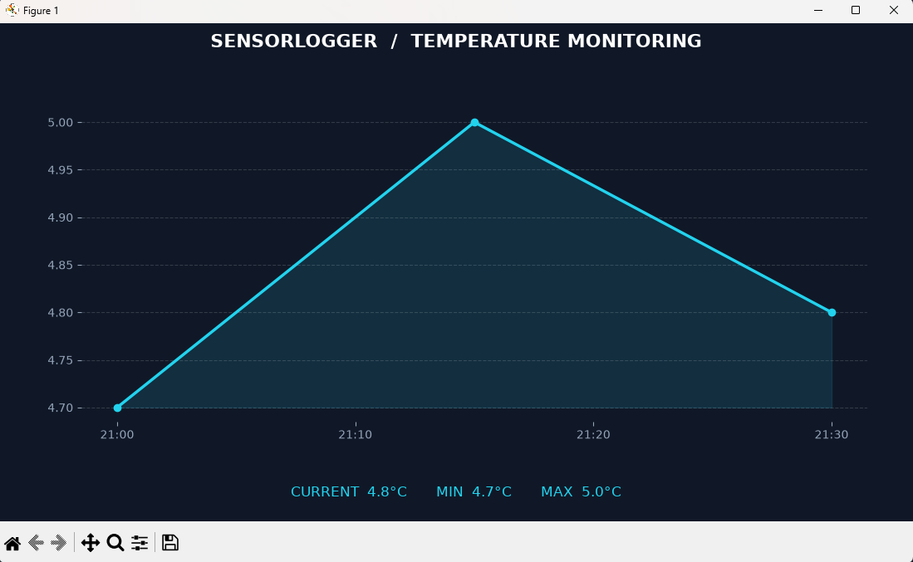

<h1 align="center">📊 SensorLogger</h1>

<p align="center">
  A lightweight Python weather monitoring system with CSV storage and temperature visualization.
</p>

<p align="center">
  
  
  
  
</p>

<p align="center">
  Simple • Open Source • Hardware-Free
</p>

---

## About

SensorLogger is a Python-based weather monitoring project designed to collect, store, analyze, and visualize temperature measurements.

The application retrieves temperature data from the **Open-Meteo API**, stores measurements in a local CSV file, and generates a dark-themed monitoring dashboard using Matplotlib.

It also prevents duplicate records and calculates the average temperature across all stored measurements.

Unlike its original version, SensorLogger v2 uses weather data from an external API instead of simulated serial measurements.

> **Note:** Open-Meteo provides weather data derived from meteorological models. Measurements are not collected directly from a physical temperature sensor.

## Features

- **Weather Data Acquisition** — Retrieves temperature and timestamp information from Open-Meteo.
- **CSV Storage** — Saves measurements locally for future analysis.
- **Duplicate Prevention** — Prevents multiple records with the same timestamp.
- **Temperature Statistics** — Calculates the average, minimum, and maximum temperatures.
- **Data Visualization** — Displays temperature trends using a dark-themed Matplotlib dashboard.
- **Error Handling** — Handles HTTP request failures and missing or empty CSV files.

## Technologies

- **Python 3** — Main programming language.
- **Requests** — Handles HTTP communication with the Open-Meteo API.
- **Matplotlib** — Creates temperature graphs and visualizations.
- **Open-Meteo API** — Provides temperature and timestamp data.
- **csv** — Python's built-in module for reading and writing CSV files.
- **datetime** — Handles and formats timestamps.
- **pathlib** — Manages filesystem paths.
- **Git & GitHub** — Version control and source code hosting.

## How It Works

1. The program sends an HTTP GET request to the Open-Meteo API.
2. The API returns the current temperature and its associated timestamp.
3. SensorLogger checks whether the timestamp already exists in `weather.csv`.
4. If the measurement is new, it is appended to the CSV file.
5. The program calculates the average temperature across stored measurements.
6. Matplotlib loads the recorded data and displays a temperature monitoring dashboard.

### Data Flow

```mermaid
flowchart LR
    subgraph S1["01 · DATA SOURCE"]
        A["Open-Meteo API"]
    end

    subgraph S2["02 · DATA PROCESSING"]
        B["HTTP Request"]
        C["JSON Parsing"]
        D["Duplicate Check"]
        B --> C --> D
    end

    subgraph S3["03 · STORAGE & ANALYSIS"]
        E["weather.csv"]
        F["Temperature Statistics"]
        E --> F
    end

    subgraph S4["04 · VISUALIZATION"]
        G["Matplotlib Dashboard"]
    end

    A --> B
    D -->|New measurement| E
    D -->|Already recorded| F
    F --> G

    classDef source fill:#DBEAFE,stroke:#2563EB,color:#1E3A8A,stroke-width:2px
    classDef process fill:#EDE9FE,stroke:#7C3AED,color:#4C1D95,stroke-width:2px
    classDef storage fill:#D1FAE5,stroke:#059669,color:#065F46,stroke-width:2px
    classDef visual fill:#CFFAFE,stroke:#0891B2,color:#164E63,stroke-width:2px

    class A source
    class B,C,D process
    class E,F storage
    class G visual

    style S1 fill:transparent,stroke:#93C5FD,stroke-width:1px
    style S2 fill:transparent,stroke:#C4B5FD,stroke-width:1px
    style S3 fill:transparent,stroke:#6EE7B7,stroke-width:1px
    style S4 fill:transparent,stroke:#67E8F9,stroke-width:1px
```



### CSV Data Storage

Measurements are automatically stored in `weather.csv`.

The file contains two columns:

- `timestamp` — Date and time associated with the measurement.
- `temperature` — Temperature in degrees Celsius.

Example:

| Timestamp | Temperature (°C) |
|:---:|:---:|
| 2026-11-22T21:00 | 4.7 |
| 2026-11-22T21:15 | 5.0 |

The application checks existing timestamps before saving new measurements, preventing duplicate records.

### Terminal Output

Example output after successfully saving a measurement:

```text
Saved measurement: 2026-11-22T21:15, 5.0°C
Average temperature: 4.85°C
```

If the timestamp already exists:

```text
Measurement for 2026-11-22T21:15 already exists.
Average temperature: 4.85°C
```

The application also handles HTTP request failures without saving incomplete measurements.

### Temperature Dashboard

SensorLogger includes a dark-themed visualization dashboard built with Matplotlib.

The dashboard displays:

- Temperature trends over time.
- Latest recorded temperature.
- Minimum and maximum recorded temperatures.
- Formatted timestamps.
- A cyan temperature line with a transparent area fill.



*Temperature monitoring dashboard generated using Matplotlib.*

## How to Run

### Requirements

- Python 3
- Git (for cloning the repository)
- Internet connection for retrieving weather data

### Installation

**1. Clone the repository:**

```bash
git clone https://github.com/noticso/SensorLogger.git
```

**2. Navigate to the project directory:**

```bash
cd SensorLogger
```

**3. Install the required dependencies:**

```bash
python -m pip install -r requirements.txt
```

The `requirements.txt` file contains:

```text
requests
matplotlib
```

### Usage

Run the application:

```bash
python sensor_logger.py
```

The program retrieves weather data, updates `weather.csv` when a new measurement is available, calculates the average temperature, and opens the visualization dashboard.

No physical Arduino or temperature sensor is required.

### Configuration

The default configuration retrieves temperature data for Turin, Italy.

The location can be changed by modifying the API parameters in `sensor_logger.py`:

```python
params = {
    "latitude": 45.07,
    "longitude": 7.69,
    "current": "temperature_2m",
    "timezone": "Europe/Rome",
}
```

Update the latitude, longitude, and timezone to monitor another location.

## Project Evolution

### Version 1 — Serial Data Logger

SensorLogger originally started as a Python serial communication exercise.

The first version used PySerial's virtual serial port (`loop://`) to simulate temperature acquisition without physical hardware.

It generated 10 temperature values, encoded and transmitted them as bytes, decoded the received data, and saved the measurements to `temperature.csv`.

**Main concepts explored:**

- Serial communication
- Byte encoding and decoding
- Virtual serial ports
- CSV file generation

### Version 2 — Weather Monitoring System

SensorLogger v2 replaced simulated serial measurements with temperature data retrieved through the Open-Meteo API.

The application was refactored into reusable functions and extended with CSV persistence, duplicate prevention, temperature statistics, HTTP error handling, and graphical visualization.

**Main concepts explored:**

- REST API integration
- HTTP requests and JSON parsing
- Modular Python programming
- File persistence
- Data validation and duplicate prevention
- Basic data analysis
- Data visualization with Matplotlib

## Future Improvements

Potential future developments include:

- Automated periodic weather data collection.
- Historical temperature analysis.
- Support for additional weather variables.
- Interactive data visualization.
- Integration with physical environmental sensors.
- Cloud-based data storage.

---

<p align="center">
  Built with Python • SensorLogger v2
</p>