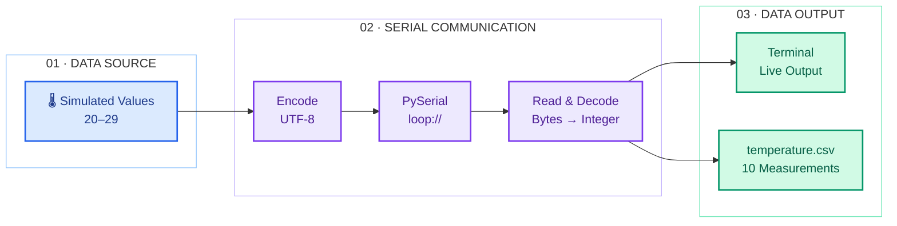

<h1 align="center">📊 SensorLogger</h1>

<p align="center">
  A lightweight Python serial data logger with CSV export.
</p>

<p align="center">
  
  
  
</p>

<p align="center">
  Simple • Open Source • Hardware-Free
</p>

---


## About

SensorLogger is a Python-based project designed to simulate serial data acquisition and store the received values in a CSV file.

It uses PySerial's virtual serial port (`loop://`) to send and receive simulated temperature values without requiring physical hardware.

## Technologies

- **Python 3** — Main programming language.
- **PySerial** — Handles virtual serial communication.
- **CSV** — Python's built-in module for storing data in CSV files.
- **Git & GitHub** — Version control and source code hosting.

## How it works

1. The program creates a virtual serial connection using PySerial's `loop://` interface.
2. It generates 10 simulated temperature values, from 20 to 29.
3. Each value is encoded into bytes and sent through the virtual serial port.
4. The program reads the received bytes and converts them into integers.
5. Each value is displayed in the terminal and saved to `temperature.csv`.

The CSV file contains two columns:
- `numero`: The measurement number.
- `temperatura`: The simulated temperature value.

### Data Flow


### Data Flow




### Sample Output

The following table shows a preview of the simulated temperature measurements stored in `temperature.csv`.

| Measurement  | Temperature (simulated) |
|:-------------:|:-----------------------:|
| 01 | 20 |
| 02 | 21 |
| 03 | 22 |
| 04 | 23 |
| 05 | 24 |
| ... | ... |
| 10 | 29 |

> **Note:** Values are simulated and do not represent actual sensor readings.

### Terminal Output

When executed, SensorLogger displays the received values in the terminal:

```text
Valore ricevuto: 20
Valore ricevuto: 21
Valore ricevuto: 22
Valore ricevuto: 23
Valore ricevuto: 24
Valore ricevuto: 25
Valore ricevuto: 26
Valore ricevuto: 27
Valore ricevuto: 28
Valore ricevuto: 29
```

The generated data is also saved automatically to `temperature.csv`.


## How to run

### Requirements

- Python 3
- Git
- PySerial

### Installation

1. Clone the repository:

   ```bash
   git clone https://github.com/noticso/SensorLogger.git
   ```

2. Navigate to the project directory:

   ```bash
   cd SensorLogger
   ```

3. Install PySerial:

   ```bash
   python -m pip install pyserial
   ```

### Usage

Run the Python script:

```bash
python lettore.py
```

The program generates 10 simulated temperature values, displays them in the terminal, and saves them to `temperature.csv`.

No physical Arduino or serial device is required.
